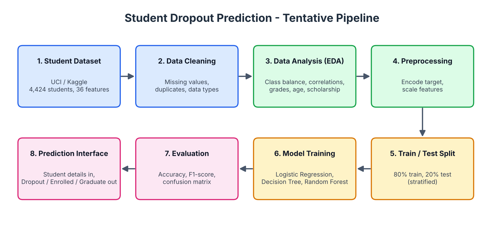

# Student Dropout and Academic Performance Prediction

A machine learning project that predicts whether a higher-education student will **Drop out, stay Enrolled or Graduate**, using demographic, socioeconomic and first- and second-semester academic data. Identifying at-risk students early lets institutions support them in time, which contributes to **UN SDG 4: Quality Education**.

## Problem statement
Many students drop out because of academic, financial and social factors, and institutions often notice only after the student has left. This project builds a model that predicts the outcome early from data available during the first two semesters.

## Dataset
- **Name:** Predict Students' Dropout and Academic Success
- **Source:** UCI Machine Learning Repository (also on Kaggle): https://archive.ics.uci.edu/dataset/697/predict+students+dropout+and+academic+success
- **Size:** 4,424 students, 36 features, no missing values
- **Target:** `Dropout`, `Enrolled`, `Graduate` (imbalanced: Graduate is the largest class)
- A copy is included as `dataset.csv`.

## Pipeline


1. **Data cleaning:** checked missing values, duplicates and data types
2. **EDA:** class balance, gender, age, scholarship, tuition status, grades, correlations
3. **Preprocessing:** target encoded as Dropout=0, Enrolled=1, Graduate=2; stratified 80/20 train/test split; `StandardScaler` fitted on the training data only (avoids data leakage)
4. **Modelling:** Logistic Regression (baseline), Decision Tree, Random Forest
5. **Evaluation:** accuracy, weighted F1-score, confusion matrix, feature importance
6. **Prediction:** probability of each outcome for a given student

## Models used
| Model | Why it was used |
|---|---|
| Logistic Regression | Simple, fast, interpretable baseline |
| Decision Tree | Easy-to-explain rules; shows how splits are made |
| Random Forest | Many trees voting together; more stable and gives feature importance |

## Results
> Fill these in from your notebook output (section 6 and 7).

| Model | Accuracy | F1 (weighted) |
|---|---|---|
| Logistic Regression | _ | _ |
| Decision Tree | _ | _ |
| Random Forest | _ | _ |

**Best model:** _  
**Most important features:** _ (see the feature importance chart in the notebook)

## How to run
1. Open `student_dropout_prediction.ipynb` in [Google Colab](https://colab.research.google.com) (File → Upload notebook).
2. Upload `dataset.csv` using the folder icon on the left.
3. Run all cells from top to bottom (Runtime → Run all).

Or locally:
```bash
pip install pandas numpy matplotlib seaborn scikit-learn jupyter
jupyter notebook student_dropout_prediction.ipynb
```

## Repository structure
```
student-dropout-prediction/
├── student_dropout_prediction.ipynb   # preprocessing, EDA, models, evaluation, prediction
├── dataset.csv                        # dataset (add this file)
├── images/
│   └── Q8_Pipeline_Architecture.png   # pipeline diagram
├── report.pdf                         # project report (add this file)
├── presentation.pptx                  # project PPT (add this file)
└── README.md
```

## Limitations and future scope
- Data comes from a single Portuguese institution, so the model may not generalise to other colleges.
- The Enrolled class is the smallest and hardest to predict.
- Future work: handle class imbalance (e.g. SMOTE), tune hyperparameters, and deploy a Streamlit web app.

## Author
_Your name_, B.Tech CSE (AI & ML), 2nd year

## Reference
Realinho, V., Machado, J., Baptista, L., Martins, M.V. (2021). *Predict students' dropout and academic success* [Dataset]. Zenodo / UCI Machine Learning Repository.
